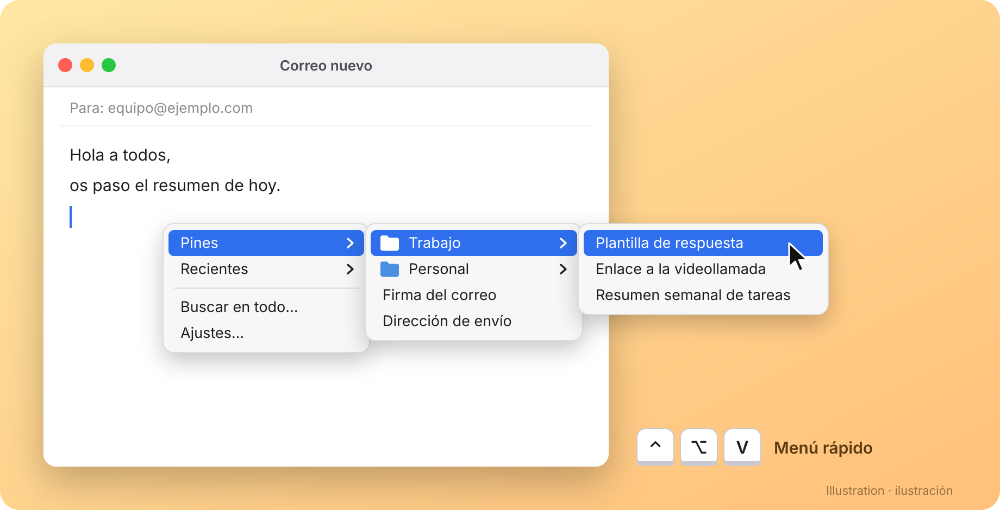
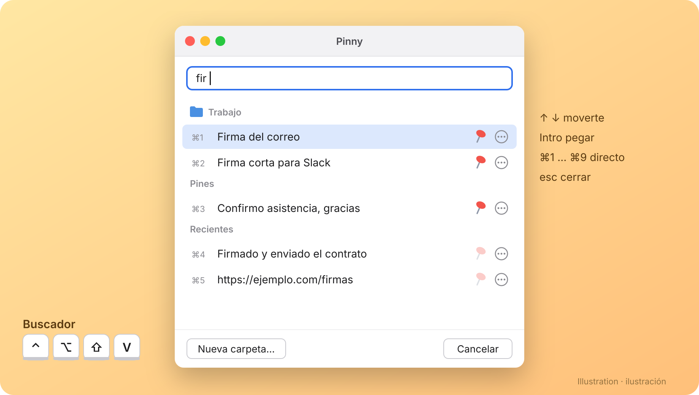
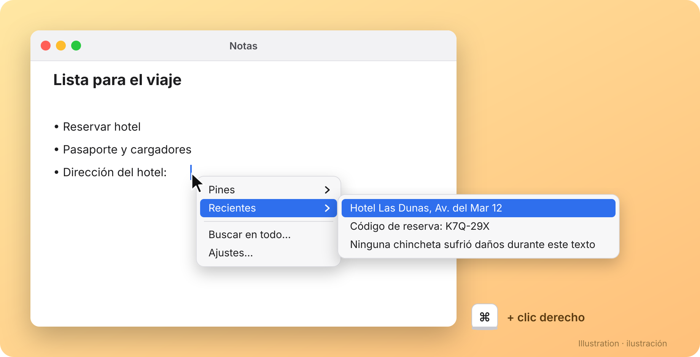

<p align="center"></p>

<p align="center"><b>A clipboard manager for macOS</b><br>
 Apple silicon · macOS 14 or later · Free and open source</p>

<p align="center"><a href="../../releases/latest"><b>⬇ Download the latest Pinny .dmg</b></a> — ready to use, no build needed</p>

<p align="center"><b>English</b> · <a href="README.es.md">Español</a></p>

# Pinny for macOS

**Your clipboard, pinned.**

Pinny is a free, open-source clipboard manager **for macOS only** (it doesn't run on Windows, Linux, iPhone or iPad). It keeps your copy history, lets you **pin** what matters, organize pins in **folders**, and paste them anywhere from a quick menu, a search panel or a right-click.

> Version **1.1.0**. Available in **English, Spanish, French, German, Italian and Portuguese (Brazil)**. It follows your Mac’s language, or you can pick one in the setup guide or in Settings. Text only for now; encrypted sync is coming in a future version.

<p align="center"></p>

## Features

- **History** of everything you copy (last 20 items by default, up to 2,000).
- **Pins** that never expire, can be reordered and grouped in **folders**.
- **Quick menu (⌃⌥V)** right at your cursor, in any app:

  ```
  Pins    ›  📁 Folder 1  ›  text
                          ›  text
             loose pin
  Recent  ›  last 10
  ```
  Pick an item and Pinny pastes it into the active app.
- **Search panel (⌃⌥⇧V):** ↑ ↓ to move, Return to paste, ⌘1…⌘9 for the first nine, Esc to close. Manage pins and folders from here.

<p align="center"></p>

- **Modifier + right-click (optional):** hold ⌘ (configurable) and right-click to open Pinny's menu anywhere, even in apps that don't support macOS Services. Without the key, right-click works as usual.
<p align="center"></p>

- **macOS Services:** *Pinny: Pins*, *Pinny: Recent*, *Pinny: Search everything* in right-click → Services.
- **Keeps your clipboard:** after pasting a pin, whatever you had copied is restored.
- **Privacy first:** everything stays on your Mac (`~/Library/Application Support/Pinny`, owner-only permissions). No network. Skips content that password managers mark as concealed, ignores apps you choose, and limits item size.
- **Safe storage:** automatic backup on every launch; a damaged data file is set aside, never overwritten.
- **Guided setup** with a live paste test, launch at login, and a built-in uninstaller.

## Install

**macOS only.** Requires a Mac with Apple silicon (M1 or later) and macOS 14 Sonoma or later.

### Option 1: download the ready-made app (recommended)

No Xcode, no Terminal, no building. Every release includes a pre-built installer:

1. Go to [**Releases**](../../releases/latest) and download `Pinny-<version>.dmg`.
2. Open it and drag **Pinny** to **Applications**.
3. Open Pinny from Applications.

Pinny is not notarized by Apple yet, so the first time macOS will block it. Go to System Settings → Privacy & Security and click **Open Anyway** (only once).

### Option 2: build from source

You need Xcode or the Command Line Tools (`xcode-select --install`).

```sh
./scripts/build-app.sh
cp -R build/Pinny.app /Applications/
open /Applications/Pinny.app
```

To create the installer (`build/Pinny-<version>.dmg`):

```sh
brew install create-dmg   # once
./scripts/make-dmg.sh
```

Tip: with the default ad-hoc signature, macOS treats every rebuild as a new app and the Accessibility permission stops working. Sign with a self-signed code-signing certificate from Keychain Access to avoid it:

```sh
SIGN_IDENTITY="Your certificate name" ./scripts/build-app.sh
```

## First launch

A setup guide walks you through three steps:

1. **Permission:** Pinny needs Accessibility to paste into other apps (on macOS 27 it's called *Device Control and Data Access*). The button opens macOS's own prompt.
2. **Right-click menu (optional):** turn on modifier + right-click and choose the key.
3. **Try it:** copy a test sentence and paste it in a box. The step turns green when it arrives.

You can reopen the guide from the menu bar icon → *Setup guide…*.

**Permission is on but nothing happens?** Use **Repair permission** in the guide or in Settings. It resets the stored permission and asks again.

## Languages

English · Español · Français · Deutsch · Italiano · Português (Brasil)

Pinny uses your Mac’s language by default. To change it, use the language menu in the setup guide or **Settings → Language**; the change is instant. The names of the macOS Services always follow the system language.

Translations other than English and Spanish are a first version: corrections are very welcome. See [CONTRIBUTING.md](CONTRIBUTING.md) to fix a translation or add a new language (one file, no coding needed).

## Uninstall

- From the app: menu bar icon → **Uninstall Pinny…** You can choose to keep or delete your history, pins and settings.
- From Terminal: `./scripts/uninstall.sh` (keeps your data) or `./scripts/uninstall.sh --purge` (deletes everything).

<sub>Images are illustrations of the app, shown with the Spanish interface.</sub>

## Known limitations

- Text only (no images or files yet).
- macOS Services only show up in apps that support them; Electron apps usually don't. Use the quick menu or modifier + right-click there.
- Services entries are fixed by macOS, so they can't list each pin. That's what the right-click menu is for.
- *Launch at login* may not work with ad-hoc signing or outside `/Applications`.

## License

[MIT](LICENSE)
